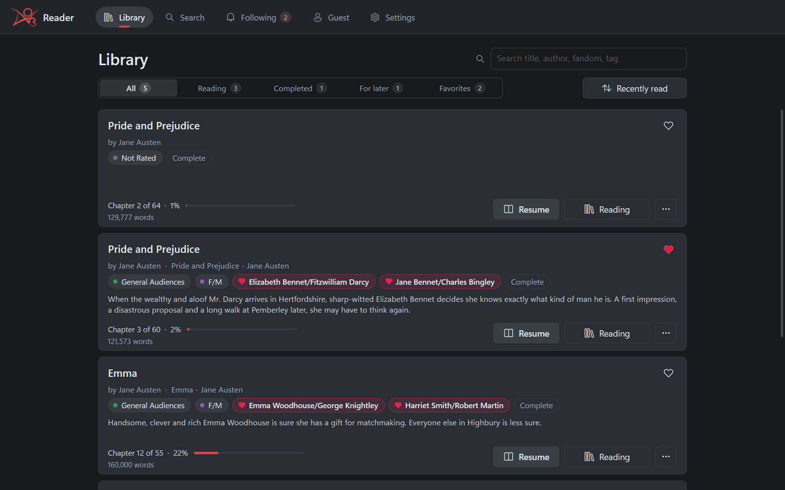
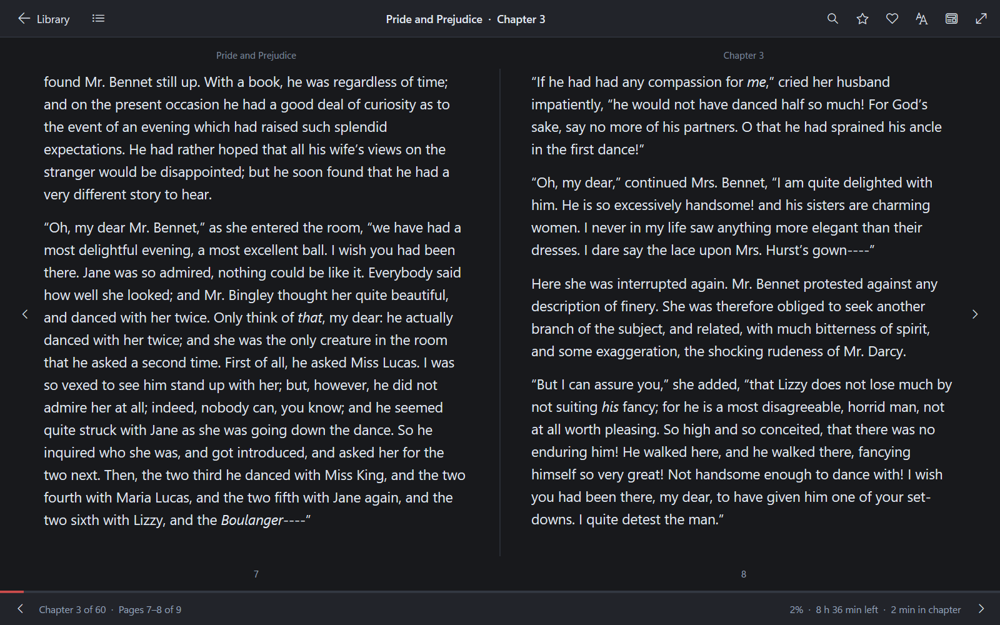
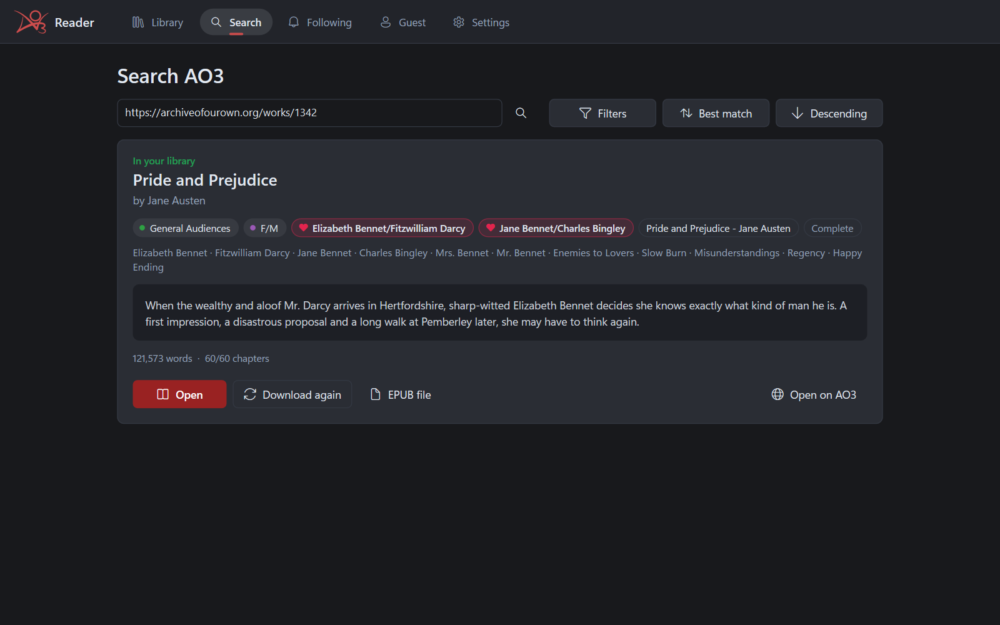
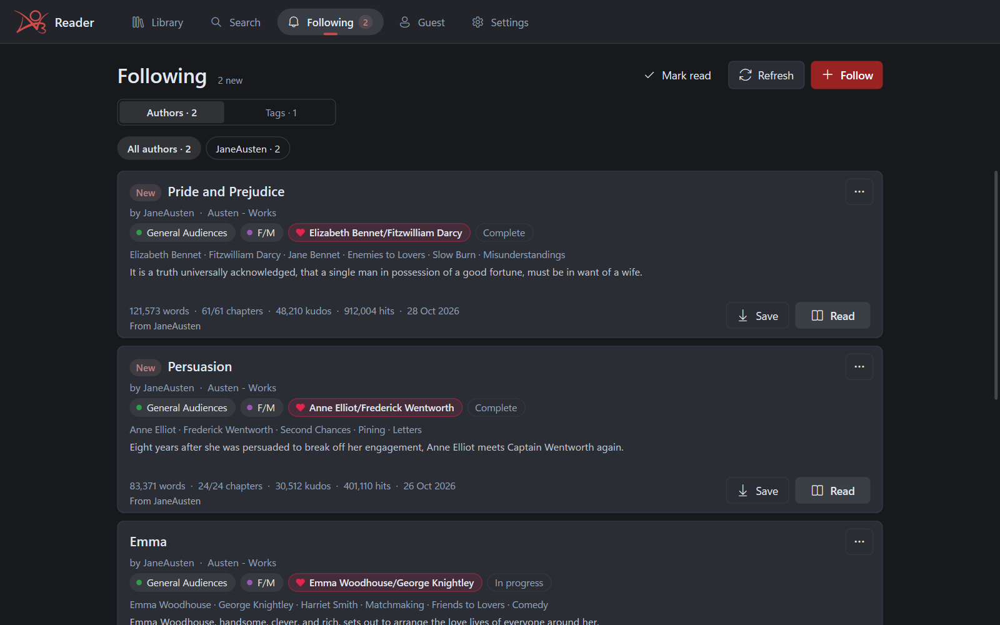
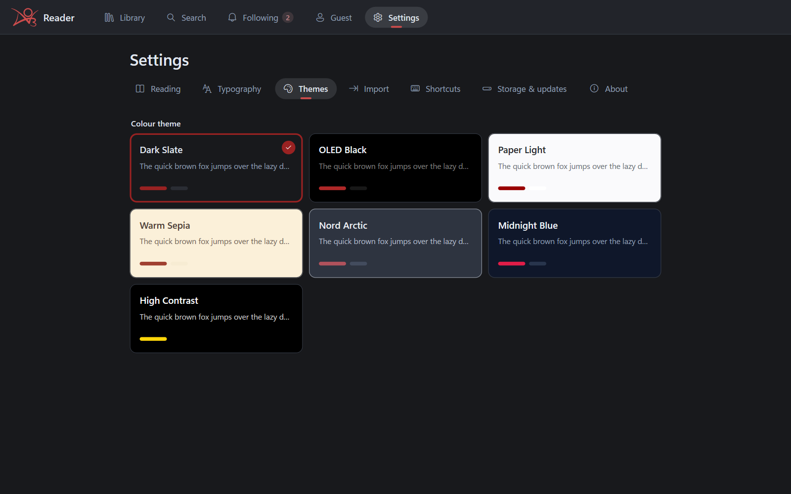
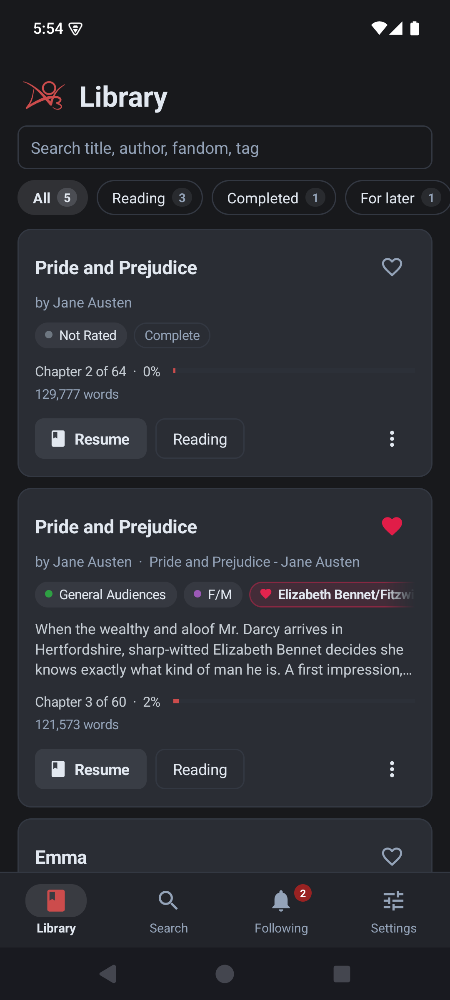
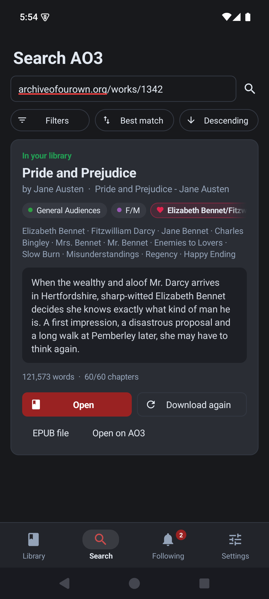
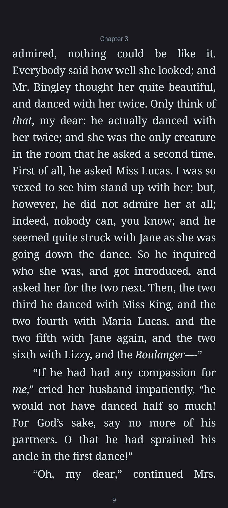
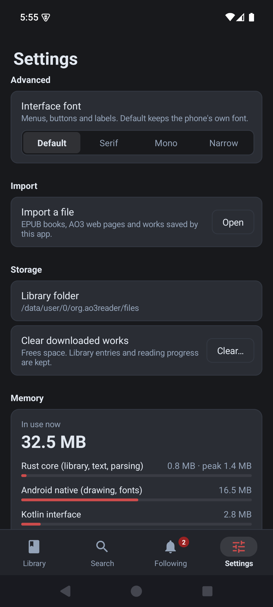

# AO3 Reader 📚

[](https://github.com/AgastyaShenoy/ao3reader/releases)
[](LICENSE)
[](https://www.rust-lang.org/)
[](https://github.com/AgastyaShenoy/ao3reader/releases)

A lightweight, unofficial reader for **Archive of Our Own**, for Windows and Android.

Find works on AO3 and save them to read offline. Turn pages like a book or scroll. Choose your own fonts and themes, and follow the authors and tags you love. It's small and quick, and your library stays on your own device.

- **Small:** the Windows app is a single 7 MB exe (a 2.7 MB download) and uses about 9 MB of memory. The Android app uses around 30 MB, most of it what Android gives every app.
- **Native:** no web view, no Electron, no GPU driver. Windows draws with Direct2D and DirectWrite on the CPU; Android uses its own built-in views.
- **Offline:** downloaded works are saved on your device and open without internet.
- **Private:** your password goes only to archiveofourown.org, and your library is never uploaded anywhere.

> **v2.1 is in beta.** AO3 is down for maintenance, so searching, following and downloading haven't been tested against the live site yet. [v1.1.0](https://github.com/AgastyaShenoy/ao3reader/releases/tag/v1.1.0) is the last stable release.

<p>


</p>

*Screenshots use public-domain novels by Jane Austen (Project Gutenberg) as sample works.*

---

## Features

### Library
- **Shelves:** Reading, Completed, For later and Favorites, each with a small count.
- **Find and sort:** search your library by title, author, fandom or tag, and sort by recently read, title, date added or author.
- **Work cards:** rating, category and warning markers, relationship tags (romantic ones get a heart), summary, and your progress.
- **Export:** save any work as a web page, Markdown or plain text.

### Search AO3
- **Search and filter:** search by keyword, or filter by fandom, relationship, character, tags, title, author, rating, status, crossovers, categories, word count, language and one-shots.
- **Sort:** by best match, date, kudos, hits, bookmarks, comments, word count, title or author.
- **Paste a link:** paste a link to a work, or any of its chapters, into the search box to see the work before downloading. Then **Read**, **Save**, get **AO3's EPUB file** or open it on AO3.

<p>


</p>

### Following
- **Follow** authors, tags (fandoms, ships, characters) and collections.
- **New and updated works** are marked, and a badge on Following shows how many are unread.
- **Gentle on AO3:** feeds are checked at most every 30 minutes, one at a time.
- **Suggestions:** authors and tags from your library are suggested, but nothing is followed unless you choose it.

### Reader
- **Pages or scroll:** turn pages like a book, with two pages side by side on wide windows, or scroll through each chapter.
- **Navigation:** contents, bookmarks with notes, and search across the whole work.
- **Progress:** chapter, page and time left. Your reading speed is learned from how fast you turn pages, or you can set it yourself.
- **Typography:** text size, line height, paragraph spacing, justified text and indents. Fonts: any installed font or a font file on Windows; sans, serif or mono on Android.
- **The work's header:** title, author, tags, summary and stats before chapter 1, with author notes and chapter summaries you can hide.
- **Kudos:** leave kudos without leaving the app.

### Themes and settings
- **Seven themes:** Dark Slate, OLED Black, Paper Light, Warm Sepia, Nord Arctic, Midnight Blue and High Contrast. Every theme is tested for readable contrast.
- **Interface font:** change the font of the app itself under Typography → Advanced. The default is the system font.
- **Import:** open EPUB books (including AO3's), AO3 web pages and works saved by the app, from Settings → Import.
- **Account:** sign in with your AO3 username and password, or a session cookie, to read works for registered users.
- **Updates:** the Windows app can check GitHub for new releases.

<p>

</p>

### Android
The Android app has the same library, search, following, reader and themes, built on the same Rust core.

<p>




</p>

---

## Install

**Windows**
1. Download `ao3reader-…-windows-x64.zip` from [Releases](https://github.com/AgastyaShenoy/ao3reader/releases).
2. Extract it and run `AO3Reader.exe`. There's no installer.

Requires 64-bit Windows 10 or 11. The exe isn't code-signed, so SmartScreen may ask you to confirm the first time.

**Android**
1. Download `ao3reader-…-android.apk` from [Releases](https://github.com/AgastyaShenoy/ao3reader/releases) on your phone.
2. Open it. If Android asks, allow your browser or file manager to install apps.

Requires Android 8.0 or newer on a 64-bit phone. The app isn't on the Play Store, so Play Protect may ask you to confirm.

---

## Keyboard shortcuts (Windows)

| Keys | Action |
| :--- | :--- |
| `→` `PgDn` `Space` | Next page |
| `←` `PgUp` `Shift+Space` | Previous page |
| `Home` / `End` | First / last page of the chapter |
| `Ctrl+→` / `Ctrl+←` | Next / previous chapter |
| `Ctrl+F` | Search in the work |
| `Ctrl+B` | Bookmark this page |
| `Ctrl+=` / `Ctrl+-` | Larger / smaller text |
| `F11` | Full screen |
| `Esc` | Close a panel or leave full screen |

---

## Where your data is kept

Everything is plain JSON in one folder: `%APPDATA%\ao3reader\ao3reader\data` on Windows, and the app's private storage on Android. To use another folder (for a portable copy, say), set the `AO3READER_DATA_DIR` environment variable.

| File | What it holds |
| :--- | :--- |
| `library.json` | Your library: each work's details, shelf, favourite, progress and bookmarks |
| `works/<id>.json` | The text of each downloaded or imported work |
| `follows.json` | Followed authors, tags and collections, and which works are new |
| `config.json` | Settings, theme, your AO3 sign-in and your learned reading speed |

Saves are crash-safe. Each file is written to a temporary file first and then swapped in, so it's never left half-written. A `.bak` copy is kept from when the app last started. If a file can't be read, it's set aside and the last good copy is used.

---

## How it's built

- **Shared core (Rust):** AO3 client (`ureq`), HTML parsing (`scraper`), EPUB import, search and follow feeds, library storage, and theme colours. It's shared by both apps.
- **Windows:** plain Win32 with Direct2D rendering on the CPU and DirectWrite text. Text boxes are native edit controls. No GPU driver is loaded.
- **Android:** Kotlin with the platform's own views and no AndroidX. It talks to the Rust core through one JNI call that passes JSON. See [android/README.md](android/README.md).

### Build from source

Requires [Rust](https://www.rust-lang.org/) 1.85 or newer.

```bash
git clone https://github.com/AgastyaShenoy/ao3reader.git
cd ao3reader
cargo build --release --features native-ui --bin ao3reader-native
```

The Windows app is `target/release/ao3reader-native.exe` (released as `AO3Reader.exe`). For Android, see [android/README.md](android/README.md). The original egui-based v1 interface still builds as `--bin ao3reader` while v2 is in beta.

---

## Attribution

> **Ideated, prompted and guided by:** [Agastya Shenoy](https://github.com/AgastyaShenoy)
> **v1 developed majorly by AI:** Google **Gemini 3.8 Flash** via Antigravity
> **v2 (native Windows rewrite, Android app) and v2.1:** developed with **Claude** (Anthropic) in Claude Code

AO3 Reader is unofficial and isn't affiliated with the Organization for Transformative Works. The AO3 logo is the OTW's trademark; the artwork comes from Wikimedia Commons.

## License

[MIT](LICENSE). Copyright (c) 2026 Agastya Shenoy.
