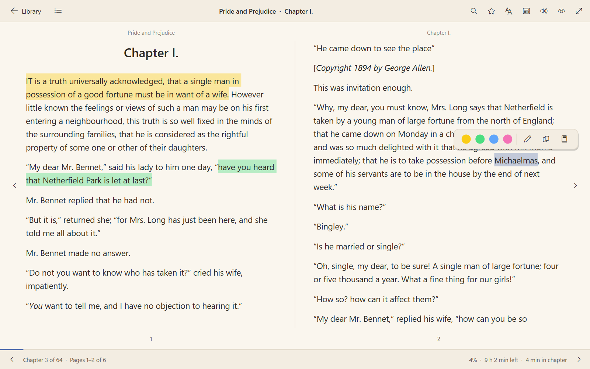
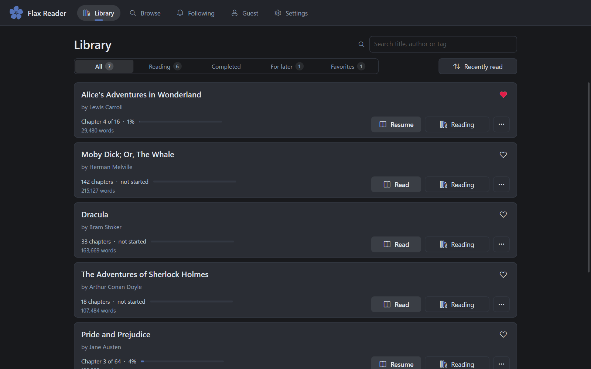
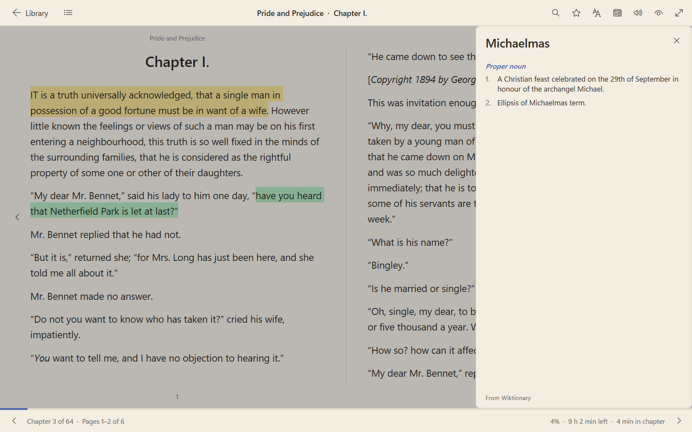
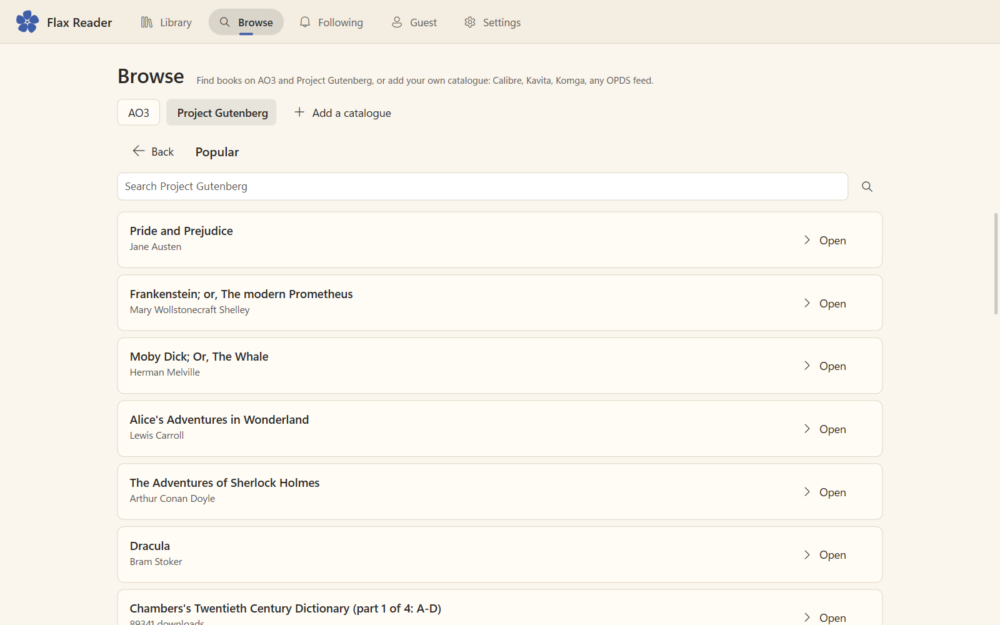
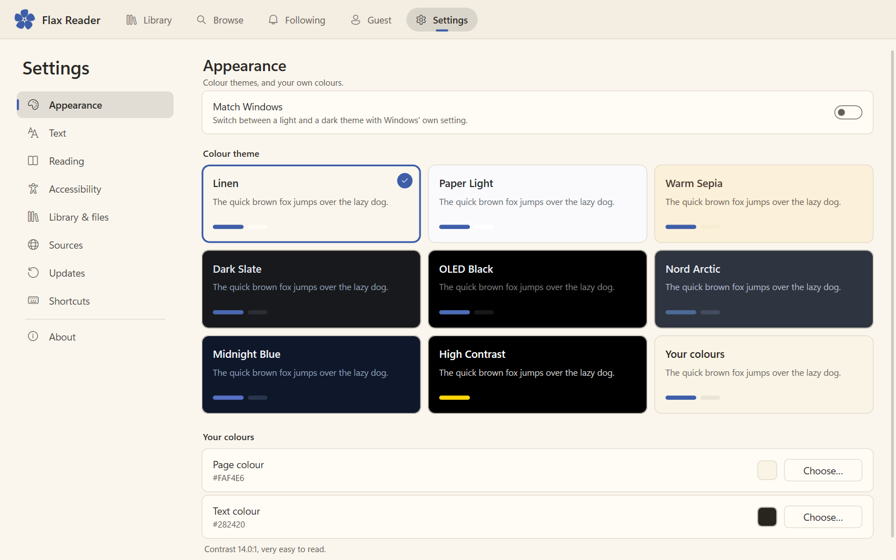
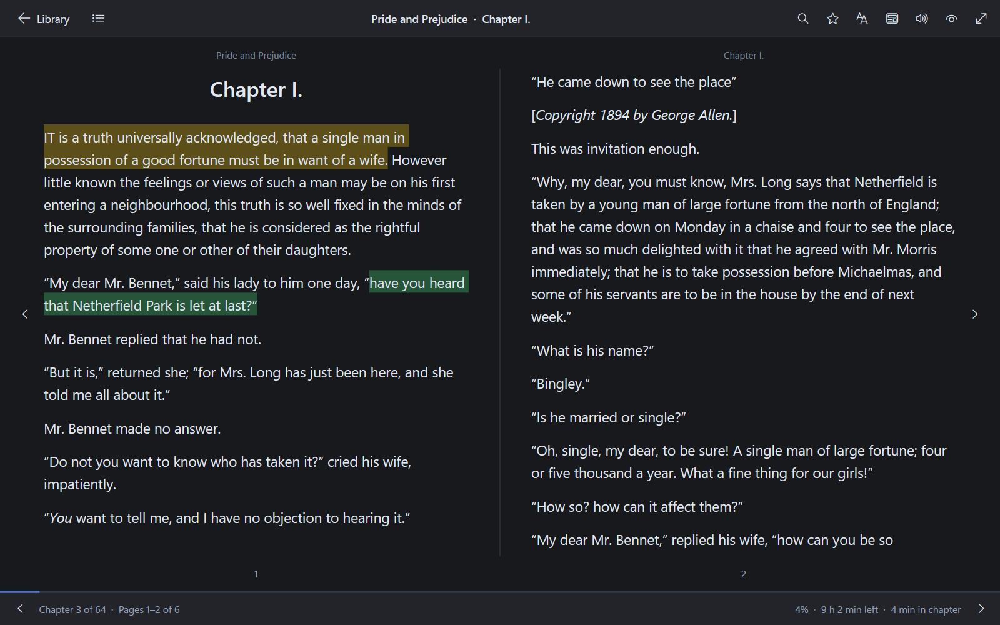
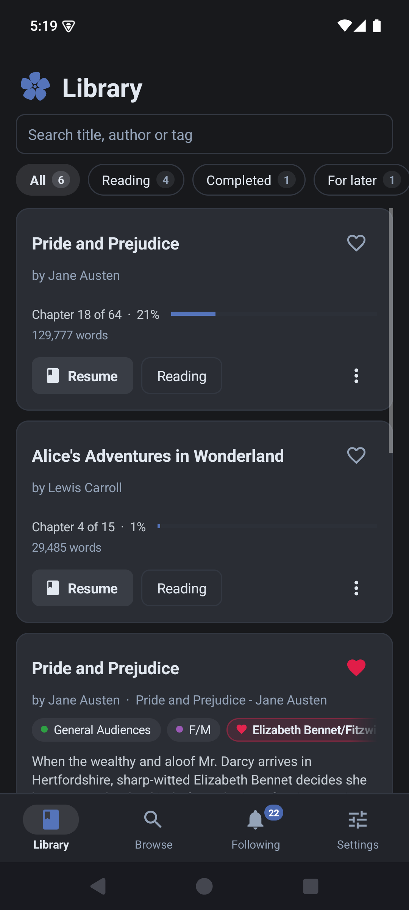
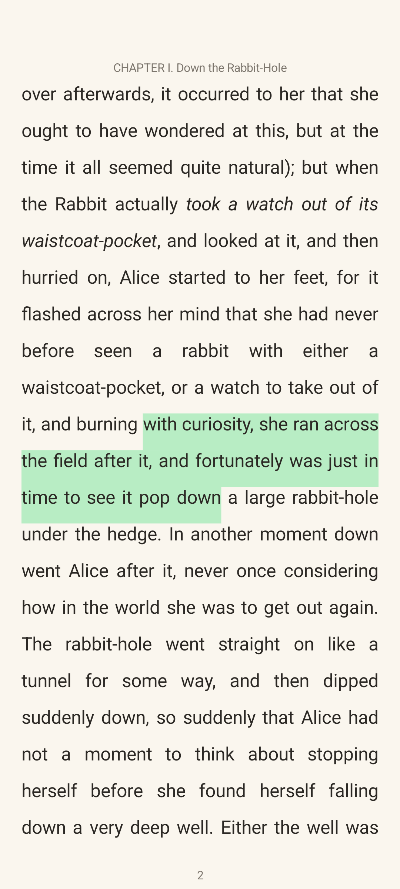
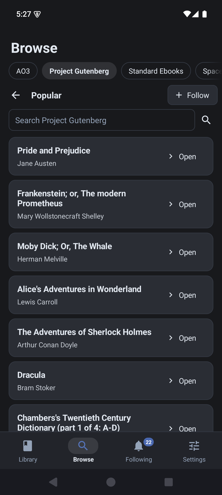
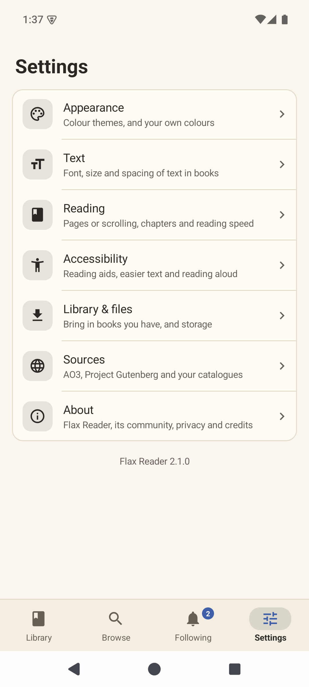

# Flax Reader

[](https://github.com/AgastyaShenoy/flax-reader/releases)
[](LICENSE)
[](https://www.rust-lang.org/)
[](https://github.com/AgastyaShenoy/flax-reader/releases)
[](https://discord.gg/3xuJY8UXKu)

A small, quick e-reader for Windows and Android.

Read the EPUB and PDF books you have, find free books on Project Gutenberg, Standard Ebooks or your own catalogues, and follow stories on SpaceBattles, Sufficient Velocity, Royal Road and Archive of Our Own. Highlight passages, add notes and look words up as you read. Themes, fonts and reading aids are made for long, comfortable reading. Your books stay on your own device.

- **Small:** the Windows app is a single exe and uses about 10–15 MB of memory while you read. There's no web view, no Electron and no GPU driver.
- **Native:** Windows draws with Direct2D and DirectWrite; Android uses its own built-in views. Both share one Rust core.
- **Offline:** books are saved on your device and open without internet.
- **Private:** no ads, no tracking and no account. The app goes online only for what you ask it to.

> [!IMPORTANT]
> **The AO3 features haven't been tested against the live site yet.** Archive of Our Own has been down for maintenance while they were built, so searching AO3, following authors and tags, downloading works, signing in and leaving kudos were only tested against saved pages. They'll be tested, and fixed where needed, once AO3 is back online. Everything else (your books, Project Gutenberg, Standard Ebooks, the story forums, Royal Road, catalogues, highlights, the dictionary) works now.

<p>


</p>

*Flax Reader used to be called AO3 Reader. Updating keeps your library, progress and settings.*

---

## Features

### Reading
- **EPUB and PDF:** EPUB books with their pictures, headings, lists and tables; PDFs page by page, as they were made (with zoom on Windows).
- **Pages or scroll:** turn pages like a book, with two pages side by side on wide windows, or scroll through each chapter.
- **Typography:** text size, line height, paragraph spacing, justified text and indents. Use any installed font or a font file on Windows; sans, serif or mono on Android.
- **Getting around:** contents, bookmarks with notes, and search across the whole book.
- **Progress:** chapter, page and time left. Your reading speed is learned from how fast you turn pages, or you can set it yourself.
- **Read aloud:** with your system's own voices.

### Highlights, notes and the dictionary
- **Highlight:** select text (drag, double-click a word, or press and hold on Android) and pick one of four colours.
- **Notes:** add a note to any highlight. Every highlight and note is listed in Contents, and takes you back to its place.
- **Look words up:** select a word and choose Define for its meanings from Wiktionary.
- **Copy:** copy any passage.

<p>


</p>

### Finding books
- **Your own files:** open EPUB books, PDFs and AO3 web pages, or open them with Flax Reader from your file manager.
- **Project Gutenberg:** browse and search tens of thousands of free books, built in.
- **Standard Ebooks:** carefully edited public-domain books, built in. Its newest releases are free to everyone; its patrons can add the full catalogue with their sign-in.
- **SpaceBattles and Sufficient Velocity:** browse the story boards, and save any story's chapters (its "threadmarks") to your library.
- **Your catalogues:** add any OPDS catalogue, such as Calibre's content server, Kavita, Komga or a library's catalogue, with a sign-in if it needs one.
- **Archive of Our Own** *(not yet tested against the live site; see above)*: search with AO3's filters, paste a link to a work, and leave kudos.
- **Other sites:** Flax Reader only fetches from sites that answer a plain request. Sites behind a bot check (FanFiction.net, Scribble Hub, Webnovel, Feedbooks) aren't fetched; save their pages or books and import them instead.

### Following
- **Stories:** paste a link to a story on SpaceBattles or Sufficient Velocity and it's saved to your library and kept up to date as new chapters come out. Royal Road stories tell you about new chapters too, which open in your browser (Royal Road's chapter pages ask for a browser check).
- **Shelves:** follow any catalogue shelf, such as Project Gutenberg's latest books, Standard Ebooks' new releases or a forum's newest stories, to see what's added.
- **AO3** *(not yet tested against the live site)*: follow authors, tags and collections.
- **New and updated** works and chapters are marked, and a badge on Following shows how many are unread. Feeds are checked at most every 30 minutes, one at a time.

### Library
- **Shelves:** Reading, Completed, For later and Favourites.
- **Find and sort:** search your library by title, author or tag, and sort by recently read, title, date added or author.
- **Export:** save a book as a web page, Markdown or plain text.

### Accessibility
- **Easier text:** Atkinson Hyperlegible and OpenDyslexic fonts are built in, with extra space between letters and words.
- **Reading aids:** a reading ruler, bold word starts and focus mode.
- **Colour:** a High Contrast theme, page tints and your own colours, each checked for readable contrast.
- **Interface:** a larger interface size, larger touch targets on Android, and keyboard and screen reader support on Windows.

### Themes and settings
- **Nine themes:** Linen, Paper Light, Warm Sepia, Dark Slate, OLED Black, Nord Arctic, Midnight Blue, High Contrast and your own colours. They can follow your system's light or dark mode.
- **Settings in categories:** Appearance, Text, Reading, Accessibility, Library & files, Sources and About (and Updates and Shortcuts on Windows).
- **Updates:** the Windows app can check GitHub for new versions.

<p>


</p>

### Android
The Android app has the same reader, highlights, dictionary, catalogues, library and themes, built on the same Rust core.

<p>




</p>

---

## Install

**Windows**
1. Download `flax-reader-…-windows-x64.zip` from [Releases](https://github.com/AgastyaShenoy/flax-reader/releases).
2. Extract it and run `FlaxReader.exe`. There's no installer.

Requires 64-bit Windows 10 or 11. The exe isn't code-signed, so SmartScreen may ask you to confirm the first time.

**Android**
1. Download `flax-reader-…-android.apk` from [Releases](https://github.com/AgastyaShenoy/flax-reader/releases) on your phone.
2. Open it. If Android asks, allow your browser or file manager to install apps. It installs over AO3 Reader and keeps your library.

Requires Android 8.0 or newer on a 64-bit phone. The app isn't on the Play Store, so Play Protect may ask you to confirm.

---

## Keyboard shortcuts (Windows)

| Keys | Action |
| :--- | :--- |
| `→` `PgDn` `Space` | Next page |
| `←` `PgUp` `Shift+Space` | Previous page |
| `Home` / `End` | First / last page of the chapter |
| `Ctrl+→` / `Ctrl+←` | Next / previous chapter |
| `Ctrl+F` | Search in the book |
| `Ctrl+B` | Bookmark this page |
| Double-click | Select a word, to highlight, copy or define it |
| `Ctrl+C` | Copy the selected text |
| `Ctrl+=` / `Ctrl+-` | Larger / smaller text |
| `R` | Read aloud, or stop |
| `F` | Focus mode |
| `F11` | Full screen |
| `Esc` | Clear a selection, close a panel, or leave focus mode or full screen |

---

## Where your data is kept

Everything is plain JSON in one folder: `%APPDATA%\ao3reader\ao3reader\data` on Windows (the folder kept its old name, so updates keep your library), and the app's private storage on Android. To use another folder (for a portable copy, say), set the `AO3READER_DATA_DIR` environment variable.

| File | What it holds |
| :--- | :--- |
| `library.json` | Your library: each book's details, shelf, favourite, progress, bookmarks, highlights and notes |
| `works/<id>.json` | The text of each book, with its pictures (or the PDF itself) beside it |
| `follows.json` | Followed stories, shelves and AO3 authors, tags and collections, and what's new in them |
| `config.json` | Settings, theme, your catalogues, your AO3 sign-in and your learned reading speed |

Saves are crash-safe. Each file is written to a temporary file first and then swapped in, so it's never left half-written. A `.bak` copy is kept from when the app last started. If a file can't be read, it's set aside and the last good copy is used.

---

## How it's built

- **Shared core (Rust):** EPUB and PDF import, OPDS catalogues, the Wiktionary lookup, the AO3 client, library storage and theme colours. Both apps use it. PDFs are drawn by a pure-Rust engine in `crates/pdf-engine` and `crates/pdf-render`.
- **Windows:** plain Win32 with Direct2D rendering on the CPU and DirectWrite text. Text boxes are native edit controls.
- **Android:** Kotlin with the platform's own views and no AndroidX. It talks to the Rust core through one JNI call that passes JSON. See [android/README.md](android/README.md).

### Build from source

Requires [Rust](https://www.rust-lang.org/); `rust-toolchain.toml` picks the right version (1.99) for you.

```bash
git clone https://github.com/AgastyaShenoy/flax-reader.git
cd flax-reader
cargo build --release --features native-ui --bin ao3reader-native
```

The Windows app is `target/release/ao3reader-native.exe` (released as `FlaxReader.exe`). For Android, see [android/README.md](android/README.md).

---

## Community

Come and chat on [Discord](https://discord.gg/3xuJY8UXKu). It's a general server, for talking about anything, and you can ask about Flax Reader there too. Found a bug? [Open an issue](https://github.com/AgastyaShenoy/flax-reader/issues).

## Attribution

> **Ideated, prompted and guided by:** [Agastya Shenoy](https://github.com/AgastyaShenoy) (aga2522)
> **v1 developed majorly by AI:** Google **Gemini 3.8 Flash** via Antigravity
> **v2 (native Windows rewrite, Android app) and Flax Reader:** developed with **Claude** (Anthropic) in Claude Code

Sample books in the screenshots are public-domain novels from Project Gutenberg. Definitions come from Wiktionary (CC BY-SA). Atkinson Hyperlegible is by the Braille Institute and OpenDyslexic by Abbie Gonzalez, both under the SIL Open Font License.

Flax Reader is unofficial and isn't affiliated with Archive of Our Own or the Organization for Transformative Works.

## License

[MIT](LICENSE). Copyright (c) 2026 Agastya Shenoy.
